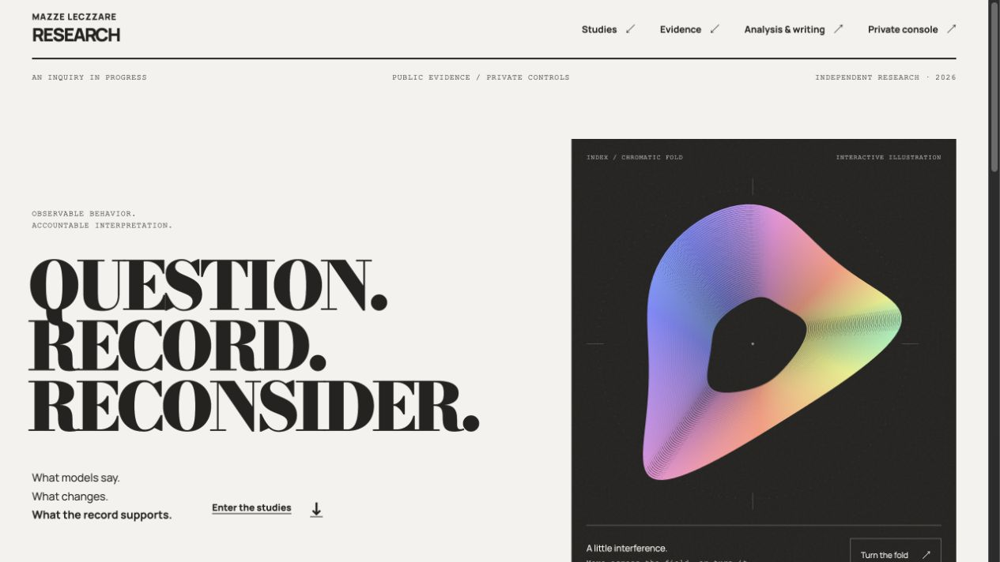

# AI Behavior Research

The research site, private study instruments and evidence registry for **observable model behavior**. Maintained by Mazze LeCzzare Frazer.

[Research site](https://research.mazzeleczzare.com/) · [Release checkpoint](https://github.com/mazze93/ai-behavior-research/releases/tag/v0.1.0-rc.1) · [Canonical research workspace](https://github.com/mazze93/Research)



*Production capture, 2026-10-16. Signed source `v0.1.0-rc.1` / `aee386e`; [deployment and byte verification](docs/research-hub/deployment-landing-2026-10-16.json).*

## What is here

| Surface | Scope and evidence |
| --- | --- |
| [Landing](apps/landing) | Static Astro 7, self-hosted type and a React study illustration. Hover/focus previews; selection persists. [Production verification](docs/research-hub/deployment-landing-2026-10-16.json). |
| [Registry](apps/registry) | Cloudflare web/API, private controls, queued inference and reviewed public releases. [Recorded deployment checks](docs/research-hub/deployment-persona-resume-2026-10-14.json); complete production file selection remains unverified. |
| [Identity Dissolution](studies/identity-dissolution) | Local runner and study protocol. Public technical smoke releases exercise the pipeline; they do not establish scientific findings. |
| [Persona Integrity](studies/persona-integrity) | Frozen v0.2 rubric, importer and contextual annotation instrument. Human scoring remains pending. |
| [Evidence tools](tools/evidence-explorer) | Source-linked Rust figures, [RustPress briefs](docs/research-hub/rustpress-integration.md) and [Hugging Face projections](docs/research-hub/huggingface-integration.md). |

The canonical research workspace is [mazze93/Research](https://github.com/mazze93/Research). This repository owns the evolving site application and its deployment instructions; included protocols retain their own versions and provenance. The two repositories are not automatically mirrored.

## Run locally

Use the versions pinned in `mise.toml`, or Node.js 22.22+ and Python 3.10+. The evidence explorer is checked with Rust 1.98.1.

```sh
mise exec -- make install
mise exec -- make test workbench
mise exec -- make registry-dev
```

`make test` includes the landing build and source/asset integrity check. After a landing rebuild, restart the local registry preview so it sees the new asset names. See [landing development](apps/landing/README.md) and [registry setup](apps/registry/README.md) for the separate build and infrastructure steps.

## Read the evidence at its actual scope

The local runner uses a sequential recovery turn; the Cloudflare runner uses independent recovery branches. Their observations are not interchangeable. Persona labels are human annotations, not metrics inferred by the registry. Private transcripts, credentials, production databases and real run exports stay outside Git.

The [public evidence dataset](https://huggingface.co/datasets/mazzeleczzare/identity-dissolution-evidence/tree/8bdbc469dfab9f3a3795217dde5c69c5ae260b06) is a derived projection of two technical smoke releases. [Publication byte checks](docs/research-hub/huggingface-publication-2026-10-12.json) and [Viewer row comparisons](docs/research-hub/huggingface-viewer-2026-10-14.json) are dated records, not new experimental results.

[Release readiness and next validations](docs/releases/v0.1.0-rc.1.md) · [Tag and artifact verification](docs/releases/README.md) · [Architecture](docs/architecture.md) · [Source inventory](provenance/README.md)

GitHub releases checkpoint source and validation. They do not deploy the site, freeze a study protocol, launch inference or publish private evidence. Licensing remains scoped to individual components and artifacts; no blanket license is granted.
