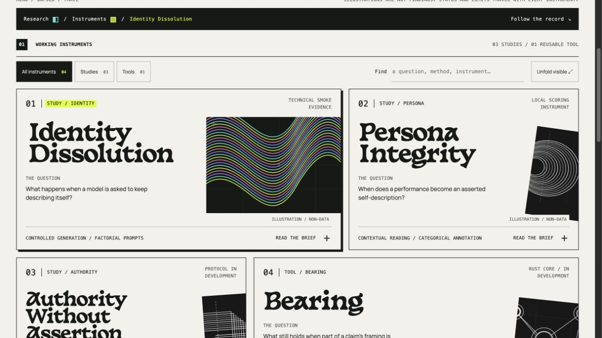
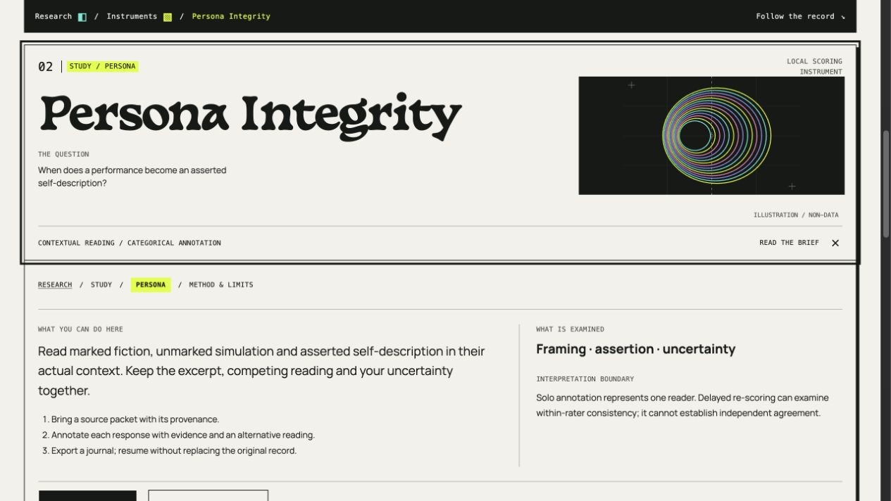

# Research cabinet / live design and verification

The landing is now the reading workspace: four instrument cards, an asymmetric index, original method specimens, native inline briefs, contextual breadcrumbs, live source hashes/citations and readable methods. It supersedes the modal landing index. Earlier React designs remain in source but are neither mounted nor bundled by the current Astro configuration. Existing dependencies are retained; none were added.

The [visual guide](cabinet-visual-guide-2026-10-25.md) was saved before implementation. The bounded primary reference pass used Experimental Jetset's archive and preface and DIA's table of contents; the archive was directly inspected. Specimens were drawn as original SVG and labeled non-data. They are not plots or model findings.

## Observed outcome

Deployed source `2ba3c0e0288bbc5ec20222ccbd8964cfa44bc105`, Worker version `42dec481-c04d-4d0f-aaa6-a32171045373`. The [production receipt](cabinet-deployment-2026-10-25.json) confirms 100% traffic, 59 source-exact public assets, 13 canonical HTML comparisons with the existing comparison-only edge-script normalization, two unchanged public evidence releases, preserved bindings/runtime and expected refusals/redirects on three anonymous private routes. Verification used system curl with HTTP/1.1 and bounded read-only transport retries. The preflight stable rollback target is `c10f0190-2dc9-4086-a0d7-0c44dd241f07`; an intermediate cabinet version `f8465904-3dcb-408c-8c89-72fd5a8491a1` preceded the final reading-position refinement.

Native card opening settles the selected brief beneath the breadcrumb bar. Reduced motion repositions instantly. Collective expansion does not scroll through every card. Filtering is confined to instruments: it never hides the evidence or methods. Search empty state, multiple open briefs, fragment entry and hover/focus states were exercised. Citations and raw-bundle actions were inspected on the live landing. Clipboard copying has a failure fallback and was not exercised against the user clipboard.

At 320px, a real question/label collision in Authority was found and corrected by placing the label in normal flex flow. Recheck found no label collisions or horizontal overflow. Both 320px and 390px geometry were checked through emulation. The screenshot transport does not faithfully capture that narrow viewport, so the saved images show the normal desktop viewport. A physical touch device and a comprehensive assistive-technology audit remain unverified.

With script execution disabled and the page reloaded, a native Identity disclosure was clicked through browser input and its `open` attribute verified through the DOM protocol. Scripting and temporary emulation settings were restored. All four native briefs remain in the server-rendered HTML; the optional toolbar appears only after its script initializes.

Local `make test` passed 66 project tests, registry type checks, Astro diagnostics/build and repository/staging checks. Subsequent refinement builds passed Astro diagnostics with zero errors/warnings/hints; the strict-CSP staging guard covers 15 landing assets and fingerprints Basteleur plus its license as explicit local inputs. The guarded Wrangler dry run passed. CI verify, Rust explorer and CodeQL checks passed on the final application revision before the documentation receipt was added. The final page references two scripts totaling 4,426 uncompressed bytes and mounts no React islands; this excludes fonts and CSS.

No experiment was launched, inference requested, protocol changed or evidence published. Authenticated Persona file selection, application login throttling and functional hosted Authority/Bearing instruments remain separate work. Status and limitations remain visible on this landing.
