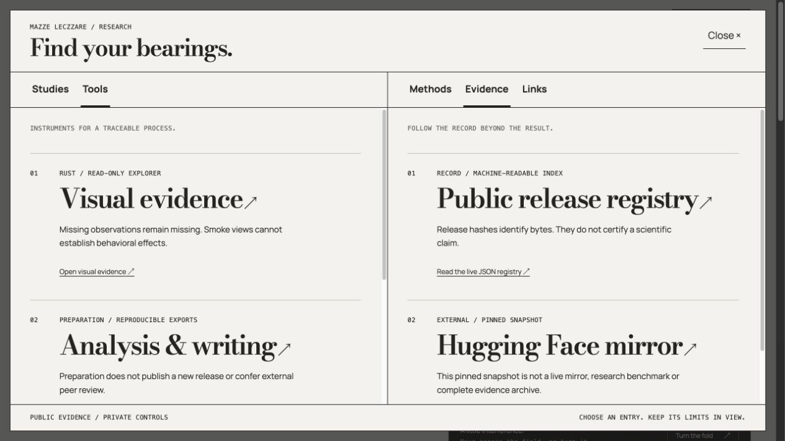
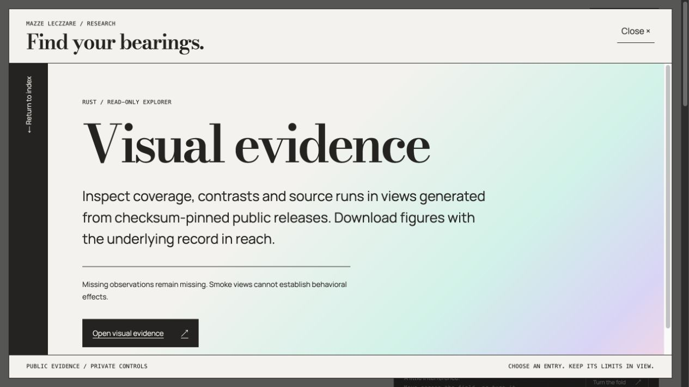

# Research navigation — production receipt

The split research index is live at https://research.mazzeleczzare.com/. PR #33 merged as `43644aa4114243be355a0e0add901380847aecf2` after all checks passed. Deployed source is its pushed head `0911ca2d71d71f05b5887775ca0d791fd155149b`; Worker version `c10f0190-2dc9-4086-a0d7-0c44dd241f07` receives 100% traffic. The previous version `ccc9e98b-5182-4fbb-bf8b-2a54d48edfff` remains the rollback target. No signed release tag was moved.

The [visual guide](navigation-guide-2026-10-25.md) records the bounded inspiration study before implementation. The reference recording and extracted frames stayed local. The index keeps research and context categories independent, opens entries into a reading surface, and restores the entry on return. Each entry has a real destination and its scope/limitations. Authority and Bearing remain labeled in development. Private controls still require authentication.

## Evidence

The [machine-readable readback](navigation-deployment-2026-10-25.json) records 65 source-exact public assets at the Worker origin, 13 canonical-domain HTML comparisons, both existing public releases unchanged, and expected 303/401 protection on three anonymous private routes. Bindings and runtime match the preflight. HTML comparisons remove only the previously documented browser bridge and edge challenge insertions; raw canonical hashes are retained separately. This is deployment consistency evidence, not scientific validation.

The first Cloudflare asset-session request failed with error 10013. A bounded retry succeeded, uploading 26 changed/new files. The first readback hit a curl HTTP/2 framing failure. The entire assertion set was rerun successfully using system curl over HTTP/1.1 with bounded transport retries; neither response data nor access controls were changed. The receipt identifies this transport explicitly. No inference retries or calls were introduced.

Local checks passed: 5 Persona importer tests, 4 Identity tests, 33 registry tests, 24 registry Python tests, both registry type checks, Astro diagnostics/build, 21 staged landing assets and the 13-asset gallery guard. Four Rust tests passed. The patched Wrangler dry run and local server both worked. Both full npm audits, including development tools, now report zero known advisories. `fast-uri` 3.1.9 also rejects/retains inert the two encoded dangerous-scheme probes while preserving a normal HTTPS URL.

Live browser checks covered the pre-hydration plain-directory fallback, hydrated opening, independent Tools/Evidence selection, the Visual evidence reading surface, Escape return/focus and entering the real gallery with both pinned smoke releases. Local emulation at 320px reported no document/detail horizontal overflow; this is not a physical-device test. The browser screenshot transport did not faithfully capture that emulated viewport, so the published images show the normal desktop viewport. A full no-JavaScript interactive browser run was not established; the fallback anchors and destinations were verified in the server-rendered HTML and through pre-hydration navigation.

The Cloudflare dashboard confirms issue detection is now enabled, with zero active issues at readback. Gateway authentication, disabled response caching and its 50-request/minute cap remain. Gateway default automatic retries were disabled and verified off. Existing logs remain enabled; log classification/export, billing and provider credentials were not expanded.

## Remaining boundaries

Application-level login throttling is not yet implemented or established through this release. Gateway limits govern inference, not login. No new owner login or authenticated Persona file-selection workflow was exercised. Authority/Bearing hosted instruments and a collaborative online lab remain separate implementation work. No model calls, protocol changes, private corpus export, new evidence publication, DNS changes or account-wide security changes occurred.
